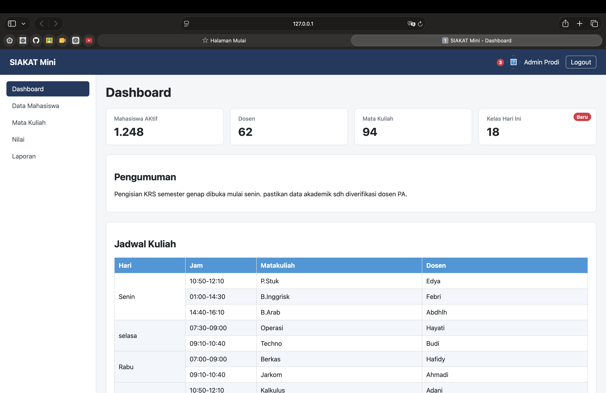
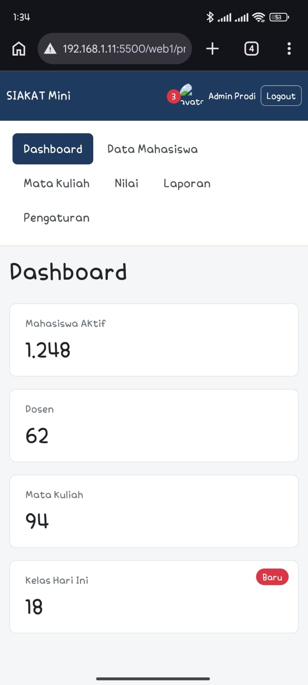

# Nama    : MUHAMMAD FAJERI RAMADHAN
# NPM     : 25100101492
# Kelas   : TI-REG 3B BANJARBARU

## Percobaan 1 - Box Model
| No | Kondisi | Lebar Koatk A(px) | Lebar Kotak B(px)|
| :---: | :---: | :---: | :---: |
| 1 | padding 20px | 350px | 300px |
| 2 | padding | 390px | 300px |

| No | Kondisi | Jarak judul-paragraf(px) |
| :---: | :---: | :---: |
| 3 | Block biasa | 799px X 76px |
| 4 | Didalam flex column | 799px X 132px |

| No | Kondisi .menu a | Latar menimpa texs lain?(ya/tidak) |
| :---: | :---: | :---: |
| 5 | inline(bawaan) | ya |
| 6 | inline | tidak |

## Percobaan 2 - Flexbok lab
| No | Properti dan Nilai | Pengamatan (tulis dengan kalimat anda sendiri) |
| :---: | :---: | :---: |
| 1 | display: flex | Tebel menjadi kolom yang dimana awalnya baris |
| 2 | justify-content: space-between | kolom "a" jadi pojok paling kiri, kolom "b" ditengah, sedangkan kolom "c" pojok kanan |
| 3 | justify-content: space-evenly | Kolom a jadi ditengah antara pojok paling kiri dan colom b, kolom b di Tengah, sedangkan kolom c diantara kolom b dan tpojok kanan |
| 4 | align-items: stretch	 vs 	center  | Stretsch full menempati lebar kolom div, dan canter Cuma mengikuti lebar items di div dan tempat nya ditenggahdc |
| 5 | flex-direction: column + 	justify-content center | Tambel berubah menjadi baris dan items berada ditenah semua |
| 6 | 8 item × 200 px, nowrap vs wrap |  Sepertiya tida ada yang berubah |
| 7 | .b { flex-grow: 1 } |  Item B mengambil ruang kosong yang tersedia, sedangkan A dan C tetap mengikuti ukuran dasarnya. |
| 8 | Lebar A / B / C (px)  | 16px x 218px/16px x 92px/ 16px x 22mgapx |
| 9 | .c { order: -1 } | Item C tampil paling kiri, tetapi urutan elemen di HTML tidak berubah. |
| 10 | .c { margin-left: auto } gap: 24px | Margin otomatis mendorong C ke kanan; gap memberi jarak 24 px di antara item. |

## Percobaan 3 - Positioning
| No | Eksperimen | Pengamatan |
| :---: | :---: | :---: |
| 1 | Header sticky saat digulir  | Saat paling atas header tidak menutupi dujul |
| 2 | Header fixed tanpa padding-top body  | Helder menutupi judul |
| 3 | Header fixed dengan padding-top 64px  | Mirip dengan sticky namun |
| 4 | .notif	 tanpa 	position: relative | Lapis 1 ke depan, lalu Lapis 2 jadi paling depan karena nilai z-index lebih tinggi. |
| 5 | .lapis-1	 z-index 3, lalu 	.lapis-2	 z-index 5 | Lapisan 3 pindah kebelang 2 |
| 6 | Header z-index 1  | Lapisan menutupi haader saat digulir |
| 7 | Tombol Bantuan di layar 375 px  | Tombol tetap berada di pojok kanan bawah viewport ketika halaman digulir. |

## Percobaan 4 - Dashboard

## Jawaban Pertanyaan Analisis 
1. Karena dengan border-box, ukuran width yang ditentukan sudah mencakup padding dan border. Hal ini membuat ukuran elemen lebih mudah dihitung dan mencegah lebar elemen menjadi lebih besar dari ukuran yang direncanakan.
2. flex-direction: column mengubah main axis menjadi vertikal. Karena itu, justify-content: center mengatur posisi item pada sumbu vertikal dan mengumpulkannya di tengah container.
3. Lebar container 1000 px. Item A memakai basis 200 px, sedangkan basis B dan C adalah 0; sisa 800 px dibagi dengan perbandingan grow 1:2. Hasilnya B sekitar 266,7 px dan C sekitar 533,3 px. Jika B memakai flex: 1 1 auto, basis B mengikuti ukuran konten awalnya, sehingga ruang sisa dibagi setelah memperhitungkan basis awal B dan C; hasil ukurannya tidak lagi otomatis 1:2 dari seluruh 800 px.
4. Karena ketika position: relative pada tombol .notif dihapus, elemen absolute mencari leluhur terdekat yang memiliki positioning. Pada contoh ini header memiliki position: sticky, sehingga badge mengacu pada header, bukan tombol notifikasi.
5. sticky tetap menjadi bagian dari aliran normal halaman, lalu menempel di atas saat halaman digulir. fixed selalu menempel pada viewport dan keluar dari aliran normal sehingga konten dapat tertutup jika tidak diberi ruang tambahan. Untuk dashboard ini saya memilih sticky karena konten awal tidak langsung tertutup navbar.
6. flex: 1 membuat wrapper mengambil ruang kosong yang tersedia di antara navbar dan footer. Jika dihapus, wrapper hanya setinggi kontennya sehingga footer dapat naik dan tidak berada di dasar layar ketika isi halaman sedikit.

## Kesimpulan
saya mempelajari cara kerja Box Model, Flexbox, dan Positioning pada halaman web. Box Model membantu mengatur ukuran elemen, Flexbox membantu menyusun tata letak, sedangkan Positioning mengatur posisi elemen terhadap halaman atau elemen lain. 